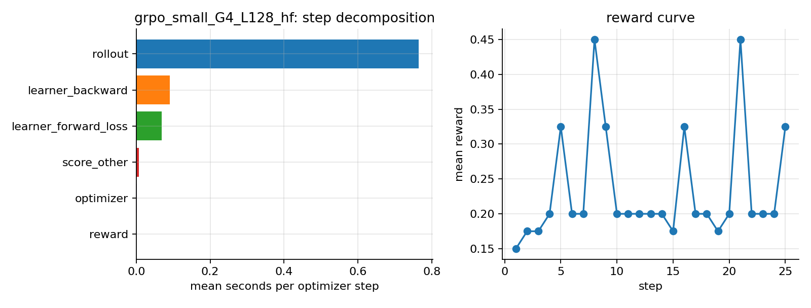

# L06. Post-training Pipeline (SFT → DPO → GRPO)

**Question.** In a post-training step, which part is the bottleneck, rollout (generation),
reward computation or the learner (forward/backward/optimizer), and which knobs move the split?

**Status.**
| Sub-experiment | Depth | Status |
|---|---|---|
| SFT with TRL + LoRA, phase-timed | Benchmark | Implemented, GPU smoke (tiny) |
| DPO with TRL + LoRA, reference-forward share (inline vs precomputed A/B) | Benchmark | Implemented, GPU smoke (tiny); A/B pending exclusive GPU |
| GRPO with verifiable GSM8K reward, rollout / reward / learner decomposition | Benchmark | Measured (pilot, 0.5B, shared GPU) |
| GSM8K accuracy gate with bootstrap CI, before/after | Benchmark | Measured (pilot, n = 100) |
| vLLM colocated rollouts vs HF generate | Benchmark | Implemented; not measured (shared-GPU OOM, see §6.5) |
| Separate rollout/learner GPUs (server mode), weight-sync cost | Explain | Planned |

**Hardware needed.** CPU for the tests; 1 GPU (~2–6 GB at the pilot settings) for the smokes and
the 0.5B pilot.

## 1. What the technique is

Post-training turns a pre-trained LM into an assistant in stages, each with a different step
anatomy:

| Stage | Objective | What one step does | Extra models / passes |
|---|---|---|---|
| **SFT** | maximise log p(response \| prompt) on curated dialogues | one forward/backward on fixed targets | none |
| **DPO** | raise log-ratio of chosen over rejected relative to a frozen reference: `-log σ(β[(log π(y_w)−log π_ref(y_w)) − (log π(y_l)−log π_ref(y_l))])` | policy forward on both completions + reference forward on both (no grad) + backward | reference model (with LoRA: same weights, adapters disabled) |
| **GRPO** | policy-gradient with group-normalised advantages: sample G completions per prompt, `A_i = (r_i − mean_G r) / std_G r`, clipped PPO-style ratio, optional KL to a reference | **rollout** (G·B sequential decodes of up to `max_completion_length` tokens) → **reward** → advantages → learner forward/backward on the sampled tokens | reference forward only if β > 0; generation engine (HF `generate` or vLLM) |

**Why the split matters.** SFT and DPO steps are a fixed number of dense forward/backward passes:
their cost scales with tokens per batch and the learner GPU is always busy. A GRPO step first has
to *produce* its training tokens by autoregressive decoding, one token per step for the longest
completion in the batch, during which the learner's compute sits idle. With HF `generate` on a
small batch this rollout can be 80–95 % of the step. The knobs are:

* **group size G and completion length L** — rollout tokens per step = B · L (B = G × prompts);
  the decode loop length is L regardless of B, so bigger B is nearly free until memory binds.
* **generation engine** — vLLM batches and pages the KV cache and uses CUDA graphs; TRL supports
  `use_vllm=True` with `vllm_mode="colocate"` (vLLM in the same process/GPU, weights synced in
  memory) or `"server"` (separate GPUs, weights pushed over the network each sync).
* **weight synchronisation** — after each learner update the generation engine needs the new
  weights; with LoRA only adapters move, with full FT the whole model. `steps_per_generation` and
  `num_iterations` reuse a rollout batch for several updates (off-policy drift vs sync cost).
* **reward** — a verifiable reward (parse the answer, compare to gold) costs microseconds; a
  reward *model* adds another forward pass per completion.
* **reference model** — β > 0 (GRPO) or any DPO step adds a no-grad forward; DPO can
  `precompute_ref_log_probs` once per dataset and remove it from the step.

**How the measurement works** (`timing_callback.py`). TRL has no rollout/learner hooks, so the
trainer *instance's* methods are wrapped (`_generate` → rollout, `_calculate_rewards` → reward,
`_generate_and_score_completions` → rollout+score, `compute_loss` → learner forward, `training_step`
→ whole step; `compute_ref_log_probs` for DPO; `vllm_generation.sync_weights` → weight sync when
vLLM is on). Nested wrappers are subtracted to give exclusive shares, and the optimizer window
comes from `on_pre_optimizer_step`/`on_optimizer_step`. Nothing in TRL is monkey-patched at class
level, and the wrappers add one `cuda.synchronize` per phase boundary.

## 2. When to use it

| Stage / knob | Use when | Not when |
|---|---|---|
| SFT first | you have demonstrations; it fixes format and is the cheapest step | the base already follows the format and you only want preference shifts |
| DPO | you have pairwise preferences and no reward model; offline, stable | you need exploration beyond the preference data; rewards are verifiable (prefer GRPO/RL) |
| GRPO with verifiable reward | correctness can be checked programmatically (math, code, formats) | the reward needs a judge model and rollouts are long and expensive |
| vLLM rollouts | rollout share > ~50 % and the model fits beside the learner (colocate) or you have spare GPUs (server) | the model is tiny and generation is already short |
| `precompute_ref_log_probs` (DPO) | many epochs over a fixed dataset | one epoch (the up-front pass costs as much as it saves) |
| Larger G | reward variance within a group is high (sparse 0/1 rewards) | memory for B·L tokens in the learner binds |

## 3. Trade-offs

| Choice | Advantages | Disadvantages |
|---|---|---|
| SFT + LoRA | one dense pass, tiny optimizer state, adapters swappable | capacity-limited; no preference signal |
| DPO (adapter-as-reference) | no second model in memory; offline; stable | 2× forward per pair (policy + reference) unless precomputed; needs preference pairs |
| `precompute_ref_log_probs` | removes the reference forward from every step | up-front pass + logp storage; stale if the dataset changes |
| GRPO + verifiable reward | no reward model, no value network, exploration | rollout-dominated step; sparse reward (all-zero groups give zero gradient, `frac_reward_zero_std`) |
| Larger `max_completion_length` | room for reasoning | decode loop grows linearly; truncated completions (`clipped_ratio`) get no answer |
| vLLM colocate | fast batched decode, CUDA graphs | shares GPU memory with the learner; weight sync each generation |
| vLLM server (separate GPUs) | learner and rollout overlap; scales rollout independently | weights cross the network; off-policy lag if async |
| `num_iterations` > 1 | amortises one rollout over several updates | off-policy ratio clipping; stale samples |

## 4. What is in this directory

| File | Purpose | Runs on |
|---|---|---|
| `rewards.py` | GSM8K gold parsing, answer extraction (`#### n` first, last number fallback), correctness / format / length rewards in TRL's signature | CPU |
| `timing_callback.py` | instance-level wrappers + `TrainerCallback` producing exclusive per-step phase times and shares | CPU |
| `common.py` | datasets (smoltalk, ultrafeedback_binarized, GSM8K rows with system prompt), LoRA config, bootstrap CI, CUDA peak helpers, shared CLI | CPU / GPU |
| `sft.py` | TRL `SFTTrainer`, LoRA, optional packing/padding-free, phase-timed, saves the adapter | GPU |
| `dpo.py` | TRL `DPOTrainer`, LoRA (adapter-disabled reference), `--precompute-ref`, reward margin/accuracy, ref-forward share | GPU |
| `grpo.py` | TRL `GRPOTrainer` on GSM8K with verifiable rewards, HF or vLLM-colocate rollouts, rollout/reward/learner breakdown, reward curve, phases figure, saves adapter | GPU |
| `eval_gsm8k.py` | greedy GSM8K accuracy with 95 % bootstrap CI and format rate, base or adapter, HF or vLLM backend | GPU (CPU possible, slow) |
| `tests/test_l06_post_training.py` | 14 CPU tests: reward parsing, exclusive phase bookkeeping with a fake trainer, bootstrap CI | CPU |

## 5. How to run

```bash
.venv/bin/python -m pytest tests/test_l06_post_training.py -q          # CPU, no network

export CUDA_DEVICE_ORDER=PCI_BUS_ID CUDA_VISIBLE_DEVICES=0
python post_training/sft.py --smoke                                     # tiny model, 3 steps each
python post_training/dpo.py --smoke
python post_training/grpo.py --smoke
python post_training/eval_gsm8k.py --smoke

# the pilot reported in §6
python post_training/eval_gsm8k.py --model small --n 100 --label eval_small_base
python post_training/grpo.py --model small --steps 25 --batch-size 8 --num-generations 4 --max-completion-length 128 --n-samples 400
python post_training/eval_gsm8k.py --model small --n 100 --adapter runs/L06_post_training/<grpo run>/adapter --label eval_small_grpo_adapter
python post_training/grpo.py --model small --steps 25 --batch-size 8 --num-generations 4 --max-completion-length 128 --use-vllm --vllm-gpu-util 0.08
```

## 6. Results

All numbers are **pilot measurements on a shared GPU** (RTX A6000 48 GB with 27–46 GB held by
other resident jobs; single run per condition). Run directories are listed in
`reports/L06_post_training/REPORT.md`.

### 6.1 GRPO step decomposition, Qwen2.5-0.5B-Instruct, HF `generate` rollouts

LoRA r=16, bf16, 2 prompts × G=4 = 8 completions per step, `max_completion_length` 128,
GSM8K train prompts, rewards = correctness (1.0) + format (0.2), β = 0, 25 steps.
Run: `runs/L06_post_training/20261029_020844_grpo_small_G4_L128_hf_96305c48bb88`.

| Phase (exclusive) | mean s / step | share |
|---|---|---|
| rollout (HF generate, 8 sequences) | 0.764 | **81.3 %** |
| reward (parse + compare) | 0.001 | 0.1 % |
| scoring other (advantages, masks) | 0.007 | 0.7 % |
| learner forward + loss | 0.068 | 7.3 % |
| learner backward | 0.090 | 9.6 % |
| optimizer (LoRA params) | 0.001 | 0.1 % |
| unaccounted | | 0.9 % |
| **step wall** | **0.94** | |

Peak allocated 8.27 GiB (reserved 8.76). Rollout throughput ≈ 188 generated tokens/s for the
whole batch, i.e. the learner GPU produced ~143 tokens per step and then trained on them in
0.16 s. **The learner is idle four fifths of the time**; the verifiable reward is free.



### 6.2 Quality gate: what the reward actually optimised

GSM8K test, n = 100 (seed 0), greedy, 256 new tokens, 95 % bootstrap CI:

| Model | accuracy | 95 % CI | `#### n` format rate | mean completion chars |
|---|---|---|---|---|
| Qwen2.5-0.5B-Instruct (base) | 0.30 | 0.21 – 0.39 | 0.11 | 743 |
| + 25 GRPO steps (adapter above) | **0.07** | 0.03 – 0.12 | **0.98** | 27 |

The training reward rose only from 0.21 to 0.28 (mean of first/last 5 steps) while the mean
completion length collapsed to 18 tokens. The policy learned the *dense, easy* format reward
(always emit `#### n`) and abandoned the step-by-step reasoning that earned the *sparse* 1.0
correctness reward, so accuracy fell by 23 points. This is a reward-design failure, not a
GRPO failure: the format term should be gated on correctness or weighted far below it, and a
minimum-length or reasoning-presence term is needed when `max_completion_length` is short. The
decomposition also explains *why* it happened so fast: short completions make the rollout cheap,
so the optimiser is additionally rewarded (in wall-clock) for brevity.

### 6.3 SFT and DPO smokes (tiny model, 3 steps; mechanics only)

| Script | step phases (share) | peak alloc GiB |
|---|---|---|
| `sft.py --smoke` | forward+loss 39 %, backward 47 %, optimizer 1 % | 1.43 |
| `dpo.py --smoke` | policy forward (incl. inline reference) 56 %, backward 34 %, optimizer 1 % | 2.35 |

The DPO policy-forward share is larger than SFT's because it runs chosen + rejected through the
policy *and* through the adapter-disabled reference in the same `compute_loss`. The
reference-forward share proper is measured by the A/B in §6.4.

### 6.4 DPO reference forward: inline vs precomputed (0.5B, LoRA, 12 steps, batch 2 × 384)

Not measured. Both runs (`--name dpo_small_lora16_inline_ref` and `..._precomp_ref`, 12 steps,
batch 2 × 384) were launched twice and both times hit `torch.OutOfMemoryError` while other
builders' jobs held GPU 0 to within 0.6 GB of full (this process was at 5.98 GB, inside its
budget); a retry guard found only 1.8 GB free. The scripts, flags and the `ref_precompute` timer
are in place; the A/B needs an exclusive GPU window. Expected shape, to be confirmed: the inline
run's `policy_forward` phase contains two no-grad passes (chosen + rejected under the disabled
adapter) on top of the policy passes, so `policy_forward(inline) − policy_forward(precomputed)`
is the per-step reference cost, and `ref_precompute_total_s` is what the precomputed run paid
once up front.

### 6.5 vLLM colocated rollouts

Not measured. Two attempts: `--vllm-gpu-util 0.08` failed inside vLLM's KV-cache sizing
(`No available memory for the cache blocks`) because in colocate mode the utilisation budget is
shared with the learner already resident in the same process; `--vllm-gpu-util 0.12` failed at
startup because the shared GPU had 0.18 GiB free at that moment. On a 48 GB GPU with a 0.5B
learner, ~0.15–0.2 is the realistic floor; the comparison is the first item on the next-experiments
list. TRL 1.9.2 supports `use_vllm=True` with `vllm_mode="colocate"` (same GPU, in-memory weight
sync via `vllm_generation.sync_weights`, which `timing_callback.py` already wraps as `weight_sync`)
and `"server"` (separate GPUs). The 2-GPU pair here is heterogeneous (A6000 + Blackwell), so a
server-mode run would also need the rollout engine pinned to one of them explicitly.

## 7. Limitations and next experiments

* Shared GPU, one run per condition, 25 steps: the phase *shares* are robust (they are ratios
  within a step), absolute seconds are not.
* The GRPO pilot is deliberately small (G = 4, L = 128, 2 prompts/step) to fit the memory cap;
  with a 6–8 GB learner the peak was already 8.3 GiB because of fp32 logits over a 152 k vocabulary.
* Fix the reward (correctness-gated format, length floor) and rerun; evaluate on n ≥ 500 so that a
  5-point change is resolvable (the n = 100 CI is ±9 points).
* vLLM colocate needs more than `gpu_memory_utilization` 0.08 next to a resident learner; rerun on
  an exclusive GPU, then server mode on the second GPU to measure weight-sync cost and
  rollout/learner overlap.
* `--num-iterations 2` and `--steps-per-generation` to amortise rollouts; G sweep (4 → 16) at fixed
  B·L to show that the decode loop length, not B, sets rollout time.
* SFT/DPO on the 0.5B model beyond the smoke, with held-out loss and win-rate.

## 8. References

* Ouyang et al., *Training language models to follow instructions with human feedback* (2022).
* Rafailov et al., *Direct Preference Optimization* (2023).
* Shao et al., *DeepSeekMath* (2024) — GRPO; DeepSeek-R1 (2025) — verifiable rewards at scale.
* TRL documentation: `GRPOTrainer` (`use_vllm`, `vllm_mode`), `DPOTrainer` (`precompute_ref_log_probs`), `SFTTrainer`.
* Hu et al., *OpenRLHF* (2024) and verl (2024) — rollout/learner separation with Ray.
