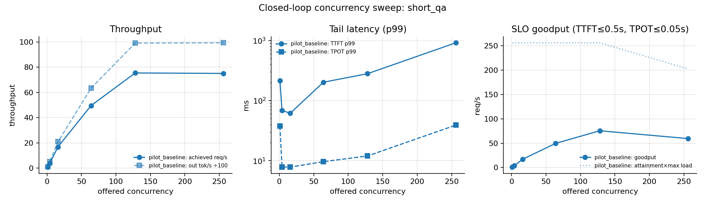
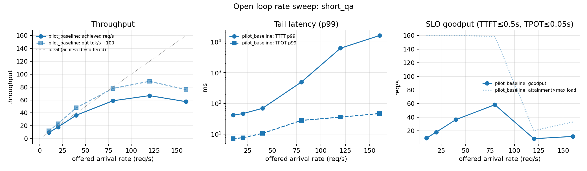
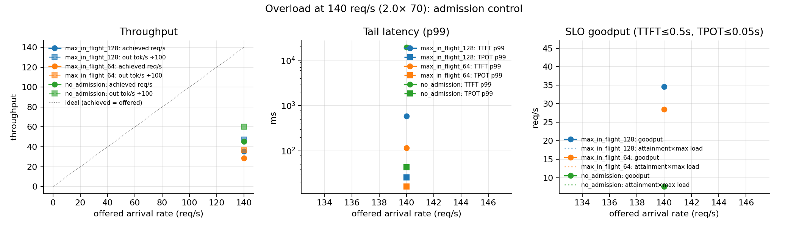
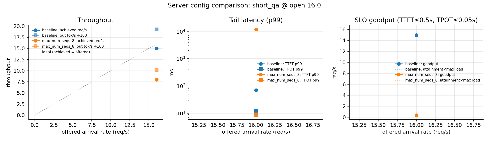

# L03. Serving SLO Lab

**Question.** What is the highest request load this server can carry while still meeting a latency target, and how do batching, scheduling and admission settings move that limit?
**Status.** Implemented (load generator, workloads, analysis, CPU tests) · Measured: *pilot only* (shared GPU, 10 % memory, eager mode; see §6). Full measurement on an exclusive GPU is pending.
**Hardware needed.** CPU only for the whole pipeline against the built-in fake server; one GPU for vLLM runs.

## 1. What the technique is

LLM serving is a queueing system whose "server" is a GPU running one *decode step* at a time.
Every knob in this lab changes either how much work fits in a step, how long a step takes, or
which requests get to join it.

### 1.1 Continuous (iteration-level) batching
Classic batching runs a fixed batch until every sequence finishes, so short requests wait for the
longest one. Continuous batching (Orca, vLLM) re-forms the batch at *every decode step*: a finished
sequence leaves, a waiting request joins, and a new request's prefill can be scheduled next step.

Cost model for one decode step with `B` sequences in flight:

```
t_step(B) ≈ t_weights + B · t_token            t_weights = model_bytes / HBM_bandwidth
TPOT       = t_step(B)                          (every running request advances one token per step)
throughput = B / t_step(B)  tokens/s            (grows ~linearly while t_weights dominates)
```

Decode is memory-bound: reading the weights once per step costs the same whether 1 or 64
sequences use them, so batching is almost free until the step becomes compute- or KV-bandwidth-bound.
The price is paid by TPOT, which grows with `B`.

### 1.2 Scheduler budgets: `max_num_seqs`, `max_num_batched_tokens`
`max_num_seqs` caps `B`; `max_num_batched_tokens` caps the number of *tokens* (prefill + decode)
processed per step. Together they bound `t_step` and therefore TPOT, at the cost of throughput and
queueing: a request that cannot join a full batch waits in the queue, which shows up as TTFT.

### 1.3 Chunked prefill
A 3 000-token prompt's prefill takes many times longer than a decode step. Without chunking it runs
as one step, and every in-flight request's next token is delayed by it (a TPOT spike, "head-of-line
blocking"). Chunked prefill (Sarathi-Serve) splits the prefill into pieces that fit the per-step token
budget and mixes them with decode tokens, so step time stays bounded. It trades a small amount of
prefill efficiency and slightly higher TTFT for the long request against stable TPOT for everyone else.

### 1.4 Prefix caching
Reuses KV-cache blocks for prompts sharing a prefix (system prompts, few-shot headers). The
mechanism is L02's subject; here it is just a server flag whose effect appears as lower TTFT on the
`long_prefix_shared` workload.

### 1.5 Closed-loop vs open-loop load
*Closed loop* keeps `N` clients busy; each waits for its reply before sending the next request. The
offered load adapts to the server, so a closed-loop test can never overload it and measures *capacity
at concurrency N*. *Open loop* submits requests at an arrival rate `λ` (Poisson here) regardless of
the server. Only open-loop load reveals queue growth: by Little's law the number of requests in the
system is `L = λ · W`, so once `λ` exceeds capacity `W` (and therefore TTFT) grows without bound.
Production traffic is open-loop; capacity planning needs both views.

### 1.6 SLO goodput
Throughput counts every completed request. *Goodput* counts only the requests that met every SLO
bound (here TTFT ≤ 0.5 s and TPOT ≤ 0.05 s by default) divided by the observed window; *attainment*
is the same count over all *submitted* requests, so time-outs, errors and admission rejections count
against the configuration. Maximum throughput and maximum goodput are different operating points,
and the gap between them is what a serving engineer tunes.

### 1.7 Admission control
Beyond saturation a FIFO queue makes *every* request late. Rejecting (or redirecting) requests that
cannot be served within the SLO keeps the served fraction useful. The load generator implements the
simplest form: a client-side cap on in-flight requests. Little's law gives the right cap:
`max_in_flight ≈ capacity (req/s) × SLO budget (s)`.

Minimal implementation vs production engine: the fake server (`fake_server.py`) is a fixed-capacity
queue with constant TTFT/TPOT, enough to exercise the client and to show queueing. vLLM is the real
engine; its scheduler flags are exposed through `server.py`.

## 2. When to use it

| Situation | What helps |
|---|---|
| Decode-heavy chat traffic, throughput matters more than per-token speed | wide `max_num_seqs`, continuous batching does the rest |
| Interactive use with strict TPOT (streaming UI) | cap `max_num_seqs` / `max_num_batched_tokens`, chunked prefill on |
| Mixed short + long prompts | chunked prefill on; otherwise long prefills stall short requests |
| Repeated system prompt / document prefix | prefix caching on |
| Bursty open-loop traffic with latency SLOs | admission control or autoscaling; queueing alone only delays the failure |
| Capacity planning | open-loop rate sweep to find the knee of the saturation curve; closed-loop sweep to find peak throughput |

## 3. Trade-offs

| Technique | Advantages | Disadvantages / cost |
|---|---|---|
| Continuous batching | near-linear throughput gain while decode is memory-bound; no padding waste; short requests are not held by long ones | TPOT grows with batch size; scheduler complexity; KV cache must be managed per token (paging) |
| Larger `max_num_seqs` / token budget | higher throughput, better GPU utilisation | higher TPOT and TTFT variance; more KV memory in flight; OOM/preemption risk |
| Chunked prefill | bounded step time, stable TPOT under mixed loads | slightly lower prefill efficiency; TTFT of the long request rises; extra scheduler state |
| Prefix caching | lower TTFT and prefill compute for shared prefixes | memory for cached blocks, hashing overhead, no gain without sharing |
| Open-loop testing | shows queueing, overload and tail behaviour like production | needs careful rate selection; results depend on the arrival process |
| Admission control | keeps goodput and tail latency bounded under overload | rejects requests (explicit errors); needs a capacity estimate; unfair without priorities |
| SLO goodput as the metric | ties engineering to the user-visible target | depends on the chosen SLO; two configs can rank differently under different SLOs |

What you pay for what you gain: batch width buys throughput with latency; chunking buys tail
stability with a little efficiency; admission control buys bounded latency with explicit failures.

## 4. What is in this directory

| File | Purpose | Runs on |
|---|---|---|
| `workloads.py` | length distributions (fixed/uniform/lognormal/dataset), arrival processes (closed/open-Poisson/burst), request classes with shared prefixes, YAML specs | CPU |
| `load_generator.py` | async streaming client (completions/chat), closed & open loop, warm-up, time-outs, client-side admission limit; writes harness runs | CPU |
| `slo_analysis.py` | p50/p95/p99, goodput/attainment for any SLO after the fact, under-sampled-p99 flag, saturation table + figure | CPU |
| `server.py`, `launch_server.sh` | start/stop a vLLM API server with scheduler knobs from `configs/l03_server_*.yaml` | GPU |
| `run_sweep.py` | `rate-sweep`, `concurrency-sweep`, `compare` (A/B server configs), `overload` (admission control); `--fake` for CPU | CPU / GPU |
| `fake_server.py` | fixed-capacity fake OpenAI server for tests and CPU smoke | CPU |
| `../benchmarks/workloads/*.yaml` | `short_qa`, `long_prefix_shared`, `mixed_burst` specs | — |
| `../tests/test_l03_*.py` | 23 CPU tests: distributions, Poisson/burst arrivals, record bookkeeping, admission, time-outs, analysis, end-to-end fake sweeps | CPU |

## 5. How to run

CPU smoke of the whole pipeline (no GPU, no model), about 20 s:

```bash
.venv/bin/python -m serving.run_sweep rate-sweep --fake --smoke --rates 20,80 --fake-capacity 4
.venv/bin/python -m pytest tests/test_l03_workloads.py tests/test_l03_load_generator.py tests/test_l03_analysis.py -q
```

GPU: start a server, then sweep. These are the commands used for the pilot in §6.

```bash
# 1. server (pilot config: 10 % of the GPU, eager, 2k context; see configs/l03_server_baseline.yaml for the normal one)
.venv/bin/python -m serving.server --config configs/l03_server_pilot_lowmem.yaml      # foreground, Ctrl-C stops it

# 2. closed-loop capacity sweep
.venv/bin/python -m serving.run_sweep concurrency-sweep --endpoint http://127.0.0.1:8010 \
    --tokenizer Qwen/Qwen2.5-0.5B-Instruct --workload benchmarks/workloads/short_qa.yaml \
    --concurrencies 1,4,16,64 --report-dir reports/L03_serving_slo/results/pilot_concurrency_sweep

# 3. open-loop rate sweep (saturation curve) and the overload point with admission control
.venv/bin/python -m serving.run_sweep rate-sweep --endpoint http://127.0.0.1:8010 \
    --tokenizer Qwen/Qwen2.5-0.5B-Instruct --rates 4,8,16,24 --duration 15 \
    --report-dir reports/L03_serving_slo/results/pilot_rate_sweep
.venv/bin/python -m serving.run_sweep overload --endpoint http://127.0.0.1:8010 \
    --tokenizer Qwen/Qwen2.5-0.5B-Instruct --rate 16 --factor 2 --max-in-flight 32 --duration 15 \
    --report-dir reports/L03_serving_slo/results/pilot_overload

# 4. A/B of scheduler settings (launches each server itself)
.venv/bin/python -m serving.run_sweep compare --server-configs configs/l03_server_baseline.yaml,configs/l03_server_small_batch.yaml \
    --mode open --rate 8 --duration 30 --tokenizer Qwen/Qwen2.5-0.5B-Instruct

# re-analyse any runs under a different SLO
.venv/bin/python -m serving.slo_analysis 'runs/L03_serving_slo/*short_qa_open*' --slo ttft=1.0,tpot=0.1 --out /tmp/slo
```

## 6. Results

All numbers in this section are **pilot, shared GPU, 10 % memory, eager mode** (see §7). Run directories
are named in each `results/*/sweep.json`; the server was `configs/l03_server_pilot_lowmem.yaml`
(`Qwen/Qwen2.5-0.5B-Instruct`, bf16, `max_num_seqs 256`, `max_num_batched_tokens 8192`, chunked
prefill on, prefix caching on, `max_model_len 2048`, `--enforce-eager`, 10 % of an RTX A6000 that
another tenant was also using). Workload `short_qa` (prompt ≈ lognormal median 128 tokens, output
lognormal median 128 tokens, `ignore_eos`), exact token counts from the model tokenizer, warm-up excluded.
SLO: TTFT ≤ 0.5 s and TPOT ≤ 0.05 s. One run per point.

### 6.1 Closed-loop concurrency sweep (`results/pilot_concurrency_sweep/`)

| label | mode | offered_load | n_success/n_submitted | req/s | out tok/s | TTFT p50/p99 (ms) | TPOT p50/p99 (ms) | E2E p99 (s) | err | goodput req/s | SLO attain. |
|---|---|---|---|---|---|---|---|---|---|---|---|
| pilot_baseline | closed | 1 | 32/32 * | 0.87 | 120 | 18/215 | 6/38 | 3.95 | 0.00 | 0.87 | 1.00 |
| pilot_baseline | closed | 4 | 32/32 * | 3.83 | 530 | 23/69 | 7/8 | 1.85 | 0.00 | 3.83 | 1.00 |
| pilot_baseline | closed | 16 | 64/64 * | 16.90 | 2095 | 25/62 | 7/8 | 1.73 | 0.00 | 16.90 | 1.00 |
| pilot_baseline | closed | 64 | 256/256 | 49.63 | 6342 | 36/202 | 8/10 | 2.07 | 0.00 | 49.63 | 1.00 |
| pilot_baseline | closed | 128 | 512/512 | 75.48 | 9914 | 85/280 | 10/12 | 2.61 | 0.00 | 75.48 | 1.00 |
| pilot_baseline | closed | 256 | 1024/1024 | 75.09 | 9937 | 381/916 | 17/39 | 6.43 | 0.00 | 59.40 | 0.79 |



Reading. Throughput scales almost linearly from 1 to 128 concurrent clients
(0.9 → 75.5 req/s, 120 → 9914 output tok/s) while TPOT p50
only doubles (6 → 10 ms): the decode step of a 0.5B model in eager mode is dominated by
fixed per-step cost, so batching is nearly free, exactly the regime §1.1 describes. Between 128
and 256 clients throughput stops growing (75.1 req/s) and the extra clients only queue: TTFT p50
goes 85 → 381 ms, TPOT p99 12 → 39 ms and SLO attainment drops to 0.79.
The KV cache was not the limit (the server log reports room for 275,696 tokens and zero
preemptions during the sweep); the step time itself grows once the batch is wide enough that the
attention and sampling work per step dominates the fixed cost. `max_num_seqs 256` then caps the
batch. The knee is at ≈ 75 req/s for this workload on this configuration.

### 6.2 Open-loop rate sweep (`results/pilot_rate_sweep/`)

| label | mode | offered_load | n_success/n_submitted | req/s | out tok/s | TTFT p50/p99 (ms) | TPOT p50/p99 (ms) | E2E p99 (s) | err | goodput req/s | SLO attain. |
|---|---|---|---|---|---|---|---|---|---|---|---|
| pilot_baseline | open | 10 | 120/120 | 9.50 | 1221 | 26/42 | 7/7 | 1.58 | 0.00 | 9.50 | 1.00 |
| pilot_baseline | open | 20 | 240/240 | 18.15 | 2335 | 27/47 | 7/8 | 1.75 | 0.00 | 18.15 | 1.00 |
| pilot_baseline | open | 40 | 480/480 | 36.47 | 4802 | 33/69 | 8/11 | 2.20 | 0.00 | 36.47 | 1.00 |
| pilot_baseline | open | 80 | 960/960 | 58.82 | 7794 | 77/497 | 11/28 | 5.30 | 0.00 | 58.39 | 0.99 |
| pilot_baseline | open | 120 | 1440/1440 | 66.84 | 8899 | 3787/6235 | 23/36 | 9.81 | 0.00 | 8.49 | 0.13 |
| pilot_baseline | open | 160 | 1920/1920 | 57.44 | 7621 | 3308/16129 | 25/47 | 20.68 | 0.00 | 11.88 | 0.21 |



Reading. Below the knee the server keeps up (achieved ≈ offered: 36.5 of 40 req/s) with flat
TTFT (p50 33 ms). At 80 req/s the achieved rate (58.8 req/s) is already below the offered rate
and TTFT p99 (497 ms) touches the SLO bound, although attainment is still 0.99. At 120 req/s
the queue grows for the whole run: TTFT p50 3.8 s, attainment 0.13, while TPOT p50 only rises
to 23 ms because the scheduler caps the batch; the damage lands entirely on time-to-first-token,
as §1.5 predicts from Little's law. At 160 req/s achieved throughput *falls* (57.4 req/s): overload
is not free even for the server, and E2E p99 reaches 21 s. Maximum throughput (≈ 67 req/s) and
maximum goodput (≈ 58 req/s at 80 offered) are different operating points.

### 6.3 Overload with client-side admission control (`results/pilot_overload/`)

Offered load 140 req/s (2× the ≈70 req/s knee), 12 s of Poisson arrivals, three client policies against the same server.

| label | mode | offered_load | n_success/n_submitted | req/s | out tok/s | TTFT p50/p99 (ms) | TPOT p50/p99 (ms) | E2E p99 (s) | err | goodput req/s | SLO attain. |
|---|---|---|---|---|---|---|---|---|---|---|---|
| max_in_flight_128 | open | 140 | 554/1680 | 35.30 | 4716 | 201/582 | 21/26 | 5.63 | 0.67 (1126 rej) | 34.59 | 0.32 |
| max_in_flight_64 | open | 140 | 427/1680 | 28.54 | 3666 | 55/117 | 15/16 | 3.36 | 0.75 (1253 rej) | 28.54 | 0.25 |
| no_admission | open | 140 | 1680/1680 | 45.33 | 6023 | 7686/19260 | 39/44 | 24.31 | 0.00 | 7.61 | 0.17 |



Reading. With no admission control every request is eventually served (1680/1680) but almost
none on time: TTFT p50 7.7 s, p99 19.3 s, goodput 7.6 req/s, attainment 0.17. Capping the
client at 128 in-flight requests rejects 1126 of 1680 arrivals outright, yet goodput rises to
34.6 req/s (4.5× the uncontrolled run) because the requests that are admitted see TTFT p50 201 ms.
A cap of 64 keeps TTFT p99 at 117 ms, inside the SLO for every served request, at the cost of
rejecting 1253. The cap is the knob that converts "everyone waits" into "a bounded share is served
well and the rest fail fast", which is the whole argument for admission control in §1.7. The
caps were chosen from Little's law (≈70 req/s × 1–2 s ≈ 70–140 in flight); the 128 cap is slightly
too generous for a 0.5 s TTFT target.

Note that absolute throughput in this sweep (45–35 req/s served) is lower than in the rate sweep
even though the server was identical: the GPU was shared with other jobs whose load changed between
sweeps (TPOT at 64 in flight was 15 ms here vs 8 ms in the closed-loop sweep). Compare rows
*within* a sweep, not across sweeps; see §7.

### 6.4 Scheduler A/B: `max_num_seqs` 256 vs 8 at 16 req/s (`results/pilot_compare_max_num_seqs/`)

Two self-launched servers, identical except `max_num_seqs` (256 vs 8), each driven at 16 req/s open-loop for 12 s.

| label | mode | offered_load | n_success/n_submitted | req/s | out tok/s | TTFT p50/p99 (ms) | TPOT p50/p99 (ms) | E2E p99 (s) | err | goodput req/s | SLO attain. |
|---|---|---|---|---|---|---|---|---|---|---|---|
| baseline | open | 16 | 192/192 | 15.01 | 1924 | 43/69 | 11/12 | 2.81 | 0.00 | 15.01 | 1.00 |
| max_num_seqs_8 | open | 16 | 192/192 | 7.96 | 1020 | 5225/11688 | 7/8 | 12.73 | 0.00 | 0.37 | 0.05 |



Reading. The narrow scheduler does deliver the faster decode step it promises (TPOT p50 7 ms vs
11 ms, because each step carries at most 8 sequences), but its capacity is ≈8 req/s, below the
offered 16, so the queue grows for the entire run: TTFT p50 5.2 s, E2E p99 13 s, goodput 0.37 req/s against
15.0 req/s for the wide scheduler. Batch width is a throughput-for-TPOT trade (§1.2); it is only a
latency win while the offered load stays below the narrowed capacity. The server-side rows in
`results/pilot_compare_max_num_seqs/summary_*.json` carry the full server configuration for each side.

## 7. Limitations and next experiments

* The pilot ran on a GPU shared with other jobs, at 10 % of its memory, in eager mode and with a
  2 048-token context: absolute numbers are far below what the hardware can do and p99 values with
  fewer than 100 requests are flagged as under-sampled. The pilot validates the harness and the
  *shape* of the curves, not the capacity of the GPU.
* Only the client view is measured. Server-side token/s (vLLM metrics endpoint) and GPU utilisation
  should be joined to the same run id to separate queueing from compute.
* Next: exclusive-GPU rate sweeps per workload (`short_qa`, `long_prefix_shared`, `mixed_burst`);
  chunked-prefill on/off on `mixed_burst`; `max_num_seqs` 8 vs 256; prefix caching on/off on
  `long_prefix_shared`; repeat each point three times and report the spread; a 7B model where
  decode is clearly memory-bound.

## 8. References

* Yu et al., *Orca: A Distributed Serving System for Transformer-Based Generative Models*, OSDI 2022 (iteration-level scheduling).
* Kwon et al., *Efficient Memory Management for Large Language Model Serving with PagedAttention*, SOSP 2023 (vLLM).
* Agrawal et al., *Taming Throughput-Latency Tradeoff in LLM Inference with Sarathi-Serve*, OSDI 2024 (chunked prefill, stall-free batching).
* Zhong et al., *DistServe*, OSDI 2024 (SLO goodput as the serving objective).
* vLLM documentation: engine arguments, chunked prefill, prefix caching; `vllm bench serve` for the reference load generator design.
* Little, J. D. C., *A Proof for the Queuing Formula L = λW*, Operations Research 1961.
