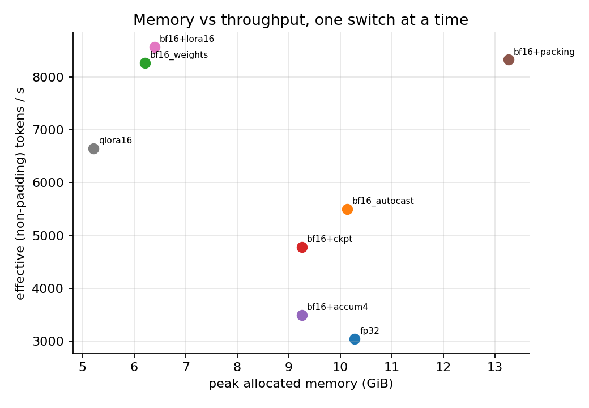
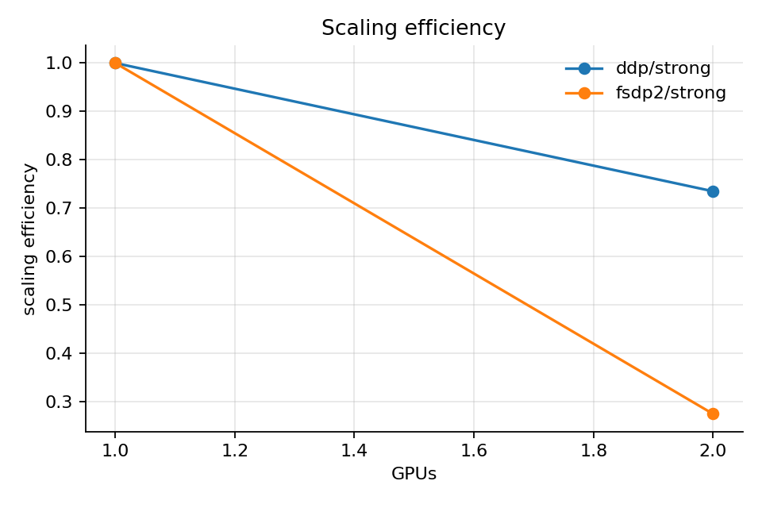

# L05. Training Efficiency & Distributed Training

**Question.** What is the trade-off between memory savings, training throughput and quality when a
single-GPU fine-tuning run is switched to mixed precision, activation checkpointing, gradient
accumulation, sequence packing or parameter-efficient fine-tuning, and what does adding a second
GPU with DDP or FSDP buy?

**Status.**
| Sub-experiment | Depth | Status |
|---|---|---|
| Sequence packing (minimal implementation, correctness vs separate forward) | Implement | Implemented, tested |
| Single-GPU switch sweep (precision / checkpointing / accumulation / packing / LoRA / QLoRA) | Benchmark | Measured (pilot, shared GPU) |
| Checkpoint save → resume equivalence | Implement | Implemented, tested (CPU bitwise, padded and packed) |
| DDP strong scaling 1 → 2 GPUs with exposed/total communication | Benchmark | Measured (smoke, tiny model, heterogeneous GPUs) |
| FSDP2 strong scaling 1 → 2 GPUs | Benchmark | Measured (smoke, tiny model, heterogeneous GPUs) |
| Weak scaling, multi-node, TP/PP | Explain | Planned (documented, not measured) |

**Hardware needed.** CPU for the tests and the simulator-style checks; 1 GPU (≥ 16 GB) for the
sweep as configured; 2 GPUs for the DDP/FSDP runs.

## 1. What the technique is

A training step on a transformer costs roughly `6 · N · T` FLOPs (N parameters, T tokens; forward
≈ 2NT, backward ≈ 4NT) and holds four kinds of state in memory:

| State | Bytes per parameter (full FT, AdamW) | Scales with |
|---|---|---|
| Weights | 4 (fp32) or 2 (bf16) | N |
| Gradients | same as weights | trainable N |
| Optimizer (AdamW `exp_avg`, `exp_avg_sq`) | 8 (fp32) or 4 (bf16) | trainable N |
| Activations | 0 per parameter; ∝ layers × batch × seq × hidden (and seq² for eager attention) | B · T · L · d |

For Qwen2.5-0.5B (494 M parameters) in fp32 the static part alone is 494 M × 16 B ≈ 7.4 GiB,
before a single activation is stored. Every switch below changes one row of that table or
changes how much useful work each step does.

### Mixed precision (AMP) vs pure bf16
*AMP* keeps fp32 master weights and optimizer state and runs matmuls under `torch.autocast` in
bf16. Memory for the static state is unchanged; compute is 2–4× cheaper on tensor cores, and
activations stored in bf16 halve. *Pure bf16* (`bf16_weights`) stores weights and AdamW state in
bf16 too, halving static memory, but weight updates smaller than the bf16 resolution of the
weight (≈ 1/256 relative) are rounded away, which can stall learning at small learning rates.
fp16 autocast additionally needs loss scaling (`GradScaler`) because fp16 underflows gradients.

### Gradient accumulation
`K` micro-batches of size `b` are back-propagated before one optimizer step, giving an effective
global batch `K · b` with the activation memory of `b`. Each micro-batch pays the full fixed cost
of a forward/backward (kernel launches, under-filled GPUs for tiny `b`), so throughput falls as
`b` shrinks even though the global batch is identical. With DDP, the gradient all-reduce is
skipped (`no_sync`) on all but the last micro-batch.

### Activation (gradient) checkpointing
Instead of keeping every layer's activations for backward, keep only the layer inputs and
recompute the layer in backward. Memory for activations drops from O(L) layers to O(1) per
checkpointed segment; compute rises by roughly one extra forward (≈ +33 % FLOPs). It only helps
when activations dominate the peak; at small models and short sequences the peak is static
state + logits and checkpointing buys little.

### Sequence packing
Samples of different lengths are concatenated into rows of exactly `seq_len` tokens
(`training/packing.py`, greedy first-fit). Three things must hold for the result to be *the same
function* as training on the samples separately: block-diagonal causal attention, per-sample
position ids, and no loss on the first token of each sample after the first (it would otherwise
be predicted from the previous sample). The minimal implementation materialises a `[B, 1, L, L]`
boolean mask (O(L²) memory, fine for L ≤ 2 k); the production path (TRL `padding_free=True`,
flash-attention varlen with `cu_seqlens`) never builds that mask.

### LoRA and QLoRA
LoRA freezes the base weights and trains a rank-`r` update `ΔW = B·A` on selected linears; the
gradient and optimizer rows shrink to the adapter size (here 1.75 % of parameters), and the
optimizer step almost disappears from the step time. QLoRA additionally stores the frozen base in
4-bit NF4 (≈ 0.5 B/param + quantisation constants) and dequantises on the fly, trading
compute for a further memory cut.

### Distributed data parallel (DDP) and fully-sharded data parallel (FSDP / ZeRO)
*DDP* replicates everything on every GPU and all-reduces gradients bucket by bucket during
backward, overlapping communication with the remaining backward compute (`bucket_cap_mb`
controls the granularity). Memory per GPU does not shrink; only the batch is split. Communication
per step is `2 · (N_trainable bytes)` per GPU (ring all-reduce), independent of the batch.
*FSDP* (ZeRO-3 style) shards weights, gradients and optimizer state across GPUs; each layer's
parameters are all-gathered right before use and freed after, gradients are reduce-scattered.
Memory per GPU falls ≈ 1/world_size for the static state, but communication rises to roughly
`3 · N bytes` per step (all-gather forward, all-gather backward, reduce-scatter), and it is
all-gathering the *full* weights even when only adapters are trainable. ZeRO-1/2 shard only
optimizer state (and gradients) and keep DDP-like communication. `reshard_after_forward=False`
keeps gathered weights between forward and backward (ZeRO-2-like memory, less communication).

*Strong scaling* fixes the global batch and splits it (`--scaling strong --global-batch G`);
*weak scaling* fixes the per-GPU batch so the global batch grows (`--scaling weak`). Reported
speedup is `step_time(1) / step_time(N)`; efficiency is speedup / N (strong) or aggregate
tokens/s over `N × single` (weak). Tensor and pipeline parallelism (splitting a layer's matmuls or
the layer stack across GPUs) are needed when one GPU cannot hold even one layer's working set;
they are documented here but not measured in this lab (see inference/multi_gpu for TP in serving).

## 2. When to use it

| Switch | Use when | Does little / hurts when |
|---|---|---|
| bf16 AMP | always on Ampere+; the default baseline | the model is tiny and launch-bound |
| pure bf16 weights | memory-bound full FT, short runs, large LR | long runs with small updates (rounding stalls) |
| gradient accumulation | the target global batch does not fit | the micro-batch gets so small the GPU idles |
| activation checkpointing | activations dominate the peak (long seq, big batch, big model) | peak is static state + logits (small models) |
| packing | many short, variable-length samples; padding > ~20 % | samples already ≈ seq_len; L² mask too big for long seq |
| LoRA | adapting a model with limited memory; many adapters per base | you need full-capacity changes (pre-training, large domain shift) |
| QLoRA | the bf16 base does not fit at all | you have the memory for LoRA (QLoRA is slower) |
| DDP | the model + optimizer fit on one GPU; you want more batch per second | you are memory-bound (DDP saves nothing) |
| FSDP/ZeRO-3 | the model + optimizer do not fit on one GPU | the model fits and the interconnect is slow (PCIe) |

## 3. Trade-offs

| Technique | Advantages | Disadvantages |
|---|---|---|
| bf16 AMP | 1.8× throughput here, no loss-scaling, fp32 master weights keep optimisation exact | no static-memory saving; optimizer step becomes the bottleneck |
| pure bf16 | halves weights + optimizer memory, fastest full-FT step here | rounding of small updates; needs care with LR schedules and long runs |
| grad accumulation | reaches any global batch at the activation cost of the micro-batch | −36 % throughput at batch 1 × 4 here; more optimizer-free steps per sample |
| checkpointing | large activation savings when activations dominate | ≈ +1 forward of compute; only −0.9 GiB here |
| packing | no padding compute, full rows, higher tokens/s | O(L²) mask in the minimal version; batch composition changes; must be implemented correctly |
| LoRA | tiny optimizer state, fast step, swappable adapters | lower capacity; LR and quality not directly comparable to full FT |
| QLoRA | lowest memory | dequantisation cost each pass (−22 % vs LoRA here); quantised base precision |
| DDP | simple, communication overlaps with backward | no memory saving; the slowest GPU bounds the step |
| FSDP2 | per-GPU memory ∝ 1/N | 3× DDP communication volume; a net slowdown on PCIe for a model that fits |

## 4. What is in this directory

| File | Purpose | Runs on |
|---|---|---|
| `packing.py` | first-fit / FFD packing, block-diagonal causal mask, restarting position ids, `cu_seqlens`, cross-sample label masking, padding accounting | CPU |
| `common.py` | one training loop shared by all scripts: data (synthetic / smoltalk / wikitext), model construction with every switch, timed step, memory accounting | CPU / GPU |
| `train_efficiency.py` | single-GPU sweep (`--sweep`), single condition, `--resume-test` checkpoint verification, figure + table | CPU / GPU |
| `distributed/dist_utils.py` | process-group setup, strong/weak batch arithmetic, NCCL kernel-time profiler probe | CPU / GPU |
| `distributed/ddp_train.py` | DDP loop, exposed-communication probe (`no_sync` vs sync), per-rank memory/throughput | 1–N GPUs |
| `distributed/fsdp_train.py` | FSDP2 `fully_shard` per decoder layer (falls back to FSDP1), mixed-precision policy, reshard option | 1–N GPUs |
| `distributed/scaling_analysis.py` | scaling table + efficiency figure from run summaries | CPU |
| `tests/test_l05_packing.py`, `tests/test_l05_training.py` | 18 CPU tests incl. packed-vs-separate forward equality, resume equality, DDP on gloo | CPU |

## 5. How to run

```bash
# CPU, no downloads: tests
.venv/bin/python -m pytest tests/test_l05_packing.py tests/test_l05_training.py -q

# CPU smoke of the loop and the resume check with a random tiny model
python training/train_efficiency.py --model random-tiny --device cpu --smoke
python training/train_efficiency.py --model random-tiny --device cpu --precision fp32 --steps 8 --resume-test

# GPU: the pilot grid (what section 6 reports)
export CUDA_DEVICE_ORDER=PCI_BUS_ID CUDA_VISIBLE_DEVICES=0
python training/train_efficiency.py --sweep --model small --dataset smoltalk --batch-size 4 --seq-len 512 --steps 30 --warmup-steps 5

# 1 vs 2 GPUs, DDP and FSDP2 (tiny model + LoRA so that it fits next to other jobs)
python -m torch.distributed.run --nproc_per_node 1 training/distributed/ddp_train.py --model tiny --dataset smoltalk --precision bf16_weights --lora 16 --scaling strong --global-batch 8 --seq-len 256 --steps 20 --probe-comm
CUDA_VISIBLE_DEVICES=0,1 python -m torch.distributed.run --nproc_per_node 2 training/distributed/ddp_train.py  ...same flags...
CUDA_VISIBLE_DEVICES=0,1 python -m torch.distributed.run --nproc_per_node 2 training/distributed/fsdp_train.py ...same flags...
python training/distributed/scaling_analysis.py
```

## 6. Results

All numbers are **pilot measurements on a shared GPU** (other jobs were resident on the same
device; absolute throughput is therefore a lower bound and run-to-run noise was not measured).
Raw run directories are listed in `reports/L05_training_efficiency/REPORT.md`.

### 6.1 Single-GPU switch sweep

Qwen2.5-0.5B-Instruct, smoltalk everyday-conversations, batch 4 × seq 512 (global batch 4),
AdamW lr 1e-4, 30 steps (5 warm-up excluded), RTX A6000 48 GB, torch 2.11 / transformers 5.7.
`fwd/bwd/opt` is the share of the measured step time. `est. static` = weights + grads + AdamW.

| condition | precision | ckpt | accum | packing | lora | trainable % | real tok/s | pad frac | peak alloc GiB | peak reserved GiB | est. static GiB | step ms | fwd/bwd/opt % | loss (last 5) |
|---|---|---|---|---|---|---|---|---|---|---|---|---|---|---|
| fp32 | fp32 | no | 1 | no | - | 100 | 3048 | 0.15 | 10.28 | 15.63 | 7.36 | 274 | 26/50/23 | 1.380 |
| bf16_autocast | bf16 AMP | no | 1 | no | - | 100 | 5503 | 0.15 | 10.13 | 15.63 | 7.36 | 152 | 21/37/41 | 1.478 |
| bf16_weights | pure bf16 | no | 1 | no | - | 100 | 8265 | 0.15 | 6.21 | 12.04 | 3.68 | 101 | 22/44/32 | 1.250 |
| bf16+ckpt | bf16 AMP | yes | 1 | no | - | 100 | 4779 | 0.15 | 9.25 | 15.72 | 7.36 | 174 | 21/42/36 | 1.478 |
| bf16+accum4 | bf16 AMP | no | 4 (batch 1) | no | - | 100 | 3497 | 0.00 | 9.26 | 10.45 | 7.36 | 238 | 23/50/26 | 1.466 |
| bf16+packing | bf16 AMP | no | 1 | yes | - | 100 | 8323 | 0.10 | 13.26 | 14.58 | 7.36 | 220 | 24/47/28 | 1.237 |
| bf16+lora16 | bf16 AMP | no | 1 | no | r=16 | 1.75 | 8563 | 0.15 | 6.40 | 12.24 | 1.97 | 97 | 42/51/5 | 0.870 |
| qlora16 | bf16 AMP | no | 1 | no | r=16 (NF4) | 2.72 | 6648 | 0.15 | 5.21 | 10.97 | 0.81 | 125 | 41/49/8 | 0.911 |



Interpretation:

* **AMP gives 1.8× throughput for zero memory change.** The static state (7.4 GiB) is fp32 in both
  cases and dominates the 10 GiB peak; the optimizer step grows from 23 % to 41 % of the step
  because AdamW over 494 M fp32 parameters is memory-bandwidth-bound and did not get faster.
* **Pure bf16 halves the static state (6.2 GiB) and is 1.5× faster than AMP**, mostly by halving
  the optimizer's bytes. Loss after 30 steps is not evidence of long-run stability.
* **Checkpointing saved only 0.9 GiB for −13 % throughput.** At 0.5 B / seq 512 / batch 4 the peak
  is static state plus the fp32 logits (4 × 512 × 151 936 × 4 B ≈ 1.2 GiB), not layer activations.
* **Accumulation (1 × 4) kept the global batch and cut reserved memory by 5 GiB, but cost 36 %
  throughput**: batch-1 micro-steps under-fill the GPU. It is a memory tool, not a speed tool.
* **Packing: 1.5× tokens/s, but not for the reason the padding fraction suggests.** Padding only
  fell from 15 % to 10 % (first-fit leaves tail space); the gain comes from every row being a
  full 512 tokens, i.e. more tokens per kernel. Peak memory rose to 13.3 GiB (more real tokens per
  step plus the materialised 4 × 512 × 512 mask). A fair "same tokens per step" comparison is a
  listed next experiment.
* **LoRA: the optimizer nearly vanishes (5 %) and the step is 1.56× faster than full AMP** at 6.4 GiB
  (fp32 frozen base; bf16 base would save another ~0.9 GiB). **QLoRA is the smallest (5.2 GiB)
  and 22 % slower than LoRA** from dequantisation in every pass.
* **Quality column is not comparable across rows**: all runs used the same lr (1e-4) and 30 steps;
  LoRA's lower loss says nothing about full-FT capacity at a tuned lr.
* **Reserved vs allocated**: the caching allocator holds up to 5.5 GiB above the allocated peak
  (fp32, AMP). Provision by reserved, report both.

### 6.2 Checkpoint / resume verification

`--resume-test` trains 8 steps continuously and 4 + (checkpoint, rebuild, resume) 4 steps on
the same seeded batch stream. CPU, random tiny model: max |Δloss| = 0.0 (bitwise) for both the
padded and the packed loader (`tests/test_l05_training.py::test_checkpoint_resume_matches_continuous_run`).
The checkpoint stores model, optimizer, step and CPU/CUDA RNG state; the loader is advanced by
`step × grad_accum` batches so the data stream is identical.

### 6.3 DDP vs FSDP2, 1 → 2 GPUs (smoke scale)

SmolLM2-135M-Instruct + LoRA r=16, pure bf16, smoltalk, **strong scaling at global batch 8**,
seq 256, 20 steps (5 warm-up). GPU 0 = RTX A6000 (sm 8.6), GPU 1 = RTX PRO 6000 Blackwell
(sm 12.0), **PCIe host-bridge link, no NVLink**, both shared with other jobs.

| strategy | GPUs | aggregate tok/s | slowest-rank step ms | peak alloc / rank GiB | speedup | efficiency | exposed comm ms | NCCL kernel ms / step |
|---|---|---|---|---|---|---|---|---|
| DDP | 1 | 15 671 | 107.7 | 3.76 | 1.00 | 1.00 | 0 | 0 |
| DDP | 2 | 23 381 | 73.3 | 2.09 | 1.47 | 0.73 | 4.5 | 10.0 |
| FSDP2 | 1 | 16 375 | 103.1 | 3.41 | 1.00 | 1.00 | - | 0 |
| FSDP2 | 2 | 9 105 | 188.2 | 2.01 | 0.55 | 0.27 | - | 108.7 |



* **DDP**: 10 ms of NCCL kernels per step of which 4.5 ms are exposed, i.e. ≈ 55 % of the
  all-reduce overlapped with backward. The remaining efficiency loss (0.73) is the heterogeneous
  pair: the step is bounded by the slower rank, and the per-rank batch of 4 under-fills both GPUs.
* **FSDP2 is a net slowdown here (0.55×)**: 109 ms of the 155 ms kernel time per step is
  all-gather/reduce-scatter over PCIe. The model fits on one GPU, only 1.75 % of the parameters
  train, and DDP therefore communicates ~57× fewer bytes. This is the textbook "do not shard what
  fits" case, measured. Per-rank memory did drop (3.4 → 2.0 GiB) as expected.
* The DDP/FSDP comparison is biased towards DDP by LoRA (DDP all-reduces only adapter
  gradients; FSDP all-gathers full weights regardless). A full-FT rerun on an exclusive GPU pair
  is pending.

## 7. Limitations and next experiments

* Shared GPUs, single repeat per condition, 30/20 steps: trends are reliable, absolute numbers and
  the loss column are not. Rerun with 3 repeats on an exclusive GPU for the report figures.
* Equal-tokens-per-step packing comparison (`--packing` with batch chosen so that real tokens per
  step match the padded run) to separate "no padding" from "bigger effective batch".
* Weak scaling, `bucket_cap_mb` sweep for DDP, `--no-reshard` (ZeRO-2-like) for FSDP2, full-FT
  0.5B on both GPUs, and a sequence-length sweep where checkpointing starts to pay.
* `fp16_autocast` + `GradScaler` is implemented but was not in the pilot grid.
* The 2-GPU pair is heterogeneous and PCIe-only; nothing here generalises to NVLink/InfiniBand
  nodes or to more than two GPUs.

## 8. References

* Micikevicius et al., *Mixed Precision Training* (2018).
* Chen et al., *Training Deep Nets with Sublinear Memory Cost* (2016) — activation checkpointing.
* Hu et al., *LoRA* (2021); Dettmers et al., *QLoRA* (2023).
* Rajbhandari et al., *ZeRO* (2020); PyTorch FSDP2 (`torch.distributed.fsdp.fully_shard`) docs.
* Li et al., *PyTorch Distributed: Experiences on Accelerating Data Parallel Training* (2020) — DDP bucketing/overlap.
* Krell et al., *Efficient Sequence Packing without Cross-contamination* (2021).
